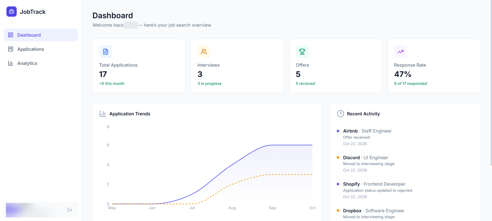
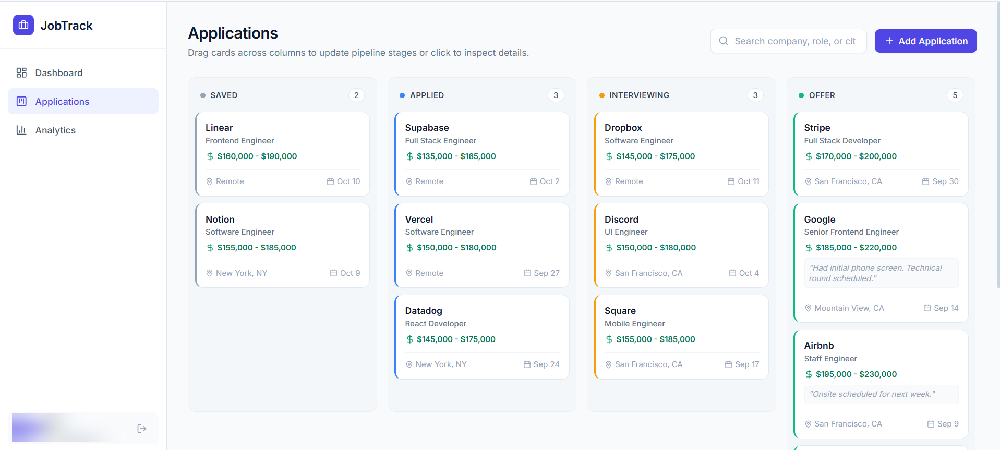
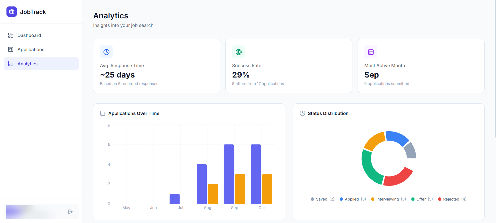

# JobTrack 💼

**A full-stack web app for organizing job applications and tracking job-search progress.**

JobTrack brings applications, interview stages, and job-search analytics into one place. Instead of relying on spreadsheets, users can manage their pipeline with a Kanban board, import details from job postings, and monitor progress with charts built from their own data.

**[Live Demo](https://jobtrack-xi-indol.vercel.app/)** · **[GitHub Repository](https://github.com/linry07/jobtrack)**

## Screenshots

Preview the Dashboard, drag-and-drop Applications board, and Analytics views. The screenshots show a populated account to demonstrate the interface.

### Dashboard



### Application Tracker



### Analytics



## Features

- **Application tracking:** Add, edit, and delete applications; organize them in a drag-and-drop Kanban board across Saved, Applied, Interviewing, Offer, and Rejected stages.
- **Smart Job Import:** Paste a job posting URL to prefill available details such as company, position, and location, then review and edit the results before saving.
- **Google authentication:** Sign in with Google through Supabase Auth. New users can choose a display name during first-time onboarding.
- **Cloud persistence and account isolation:** Store application and activity records in Supabase PostgreSQL, with Row Level Security (RLS) limiting access to each user's records.
- **Dashboard and analytics:** Explore application volume, status distribution, response trends, and pipeline progress using interactive charts based on actual application and activity data. Empty accounts show meaningful empty states rather than sample statistics.
- **Responsive interface:** Manage applications on desktop or mobile.

## Tech Stack

| Layer | Technologies |
| --- | --- |
| Frontend | React, TypeScript, Vite, Tailwind CSS |
| Routing and UI | React Router, Recharts, Lucide React |
| Authentication | Supabase Auth, Google OAuth |
| Database | Supabase PostgreSQL, Row Level Security |
| Job import | Server-side API endpoints deployed with Vercel |
| Deployment | Vercel |

## How It Works

1. **Authenticate:** Google sign-in creates or restores a Supabase Auth session. First-time users select a display name.
2. **Track applications:** The frontend reads and updates applications and activity history in Supabase; database RLS restricts access to the authenticated user.
3. **Import job details:** The user submits a job posting URL, reviews the extracted fields, and decides what to save. Extraction can vary by job site, so manual editing is supported.
4. **Analyze progress:** Dashboard and Analytics views compute summaries and charts from stored records. Response-time metrics use recorded response milestones when available rather than treating ordinary edits as employer responses.

## Running Locally

### Prerequisites

- Node.js and npm
- A Supabase project
- Google OAuth credentials configured for your Supabase project if you want to test Google sign-in

### Install

```bash
git clone https://github.com/linry07/jobtrack.git
cd jobtrack
npm install
```

### Configure environment variables

Create a `.env.local` file in the project root using the variable names in `.env.example`:

```dotenv
VITE_SUPABASE_URL=https://your-project-ref.supabase.co
VITE_SUPABASE_ANON_KEY=your_supabase_publishable_or_anon_key
```

Use a Supabase **publishable/anon key**, not a secret or `service_role` key. Never commit `.env.local` or any private credentials.

Apply the project database schema from `supabase/migrations` to your Supabase project. In Supabase Authentication settings, enable and configure Google sign-in and allow your local redirect URL (typically `http://localhost:5173/**`). Your Google OAuth client must use the callback URL shown by Supabase.

### Start the app

```bash
npm run dev
```

Open the local address printed by Vite (typically `http://localhost:5173`).

## Testing and Build

```bash
npm test
npm run test:sample-data
node tests/display-name.test.mjs
node tests/login-auth-options.test.mjs
npm run build
```

The project includes regression checks for Smart Job Import, user onboarding, login-page behavior, and data-driven analytics. Some integration or multi-user security checks require separately configured test credentials; see the relevant test scripts before running them.

## Project Structure

```text
api/                  Server-side job-import endpoints
src/
  components/         Shared UI and authentication components
  context/            Authentication and application state
  pages/              Dashboard, Applications, Analytics, and login views
  types/              Shared TypeScript definitions
supabase/migrations/  Database schema and access policies
tests/                Regression and integration tests
```

## Notes

- Job Import results depend on the structure and accessibility of each job posting; all imported fields can be reviewed before an application is saved.
- Application and analytics data is specific to the signed-in user. Newly created accounts do not start with seeded demo applications.

---

Built as a project exploring full-stack development, authentication, database security, and data visualization.
